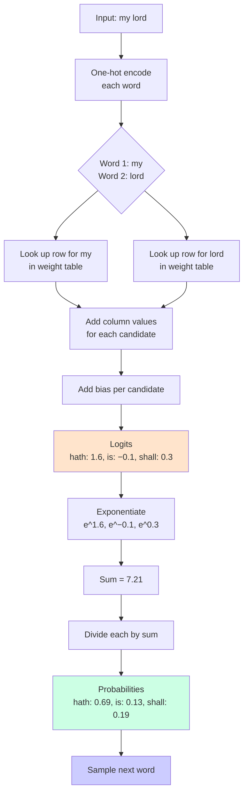

# Bard Forward Pass

Given the input `"my lord"`, Bard produces a score (logit) for every candidate next word. Each score is computed as:

> **score = bias + weight(my, position 1) + weight(lord, position 2)**

## Worked Example

| Candidate | Bias | Weight from `my` | Weight from `lord` | **Logit** |
|-----------|------|------------------|--------------------|-----------|
| `hath`    | 0.1  | 0.5              | 1.0                | **1.6**   |
| `is`      | 0.0  | 0.2              | −0.3               | **−0.1**  |
| `shall`   | −0.1 | 0.0              | 0.4                | **0.3**   |

- **Biases** are the baseline score for each word, independent of context.
- **Weights** capture how each context word pushes each candidate up or down — these are what the model learns.
- Logits can be negative and don't sum to anything meaningful.

## From Logits to Probabilities (Softmax)

1. **Exponentiate** each logit: `e^1.6 ≈ 4.95`, `e^−0.1 ≈ 0.90`, `e^0.3 ≈ 1.35`
2. **Sum** the exponentials: `4.95 + 0.90 + 1.35 = 7.21`
3. **Divide** each by the sum to get probabilities:

| Candidate | Exp   | Probability |
|-----------|-------|-------------|
| `hath`    | 4.95  | **≈ 0.69**  |
| `is`      | 0.90  | **≈ 0.13**  |
| `shall`   | 1.35  | **≈ 0.19**  |

Probabilities are all positive, sum to 1, and the highest logit gets the largest share — yielding a usable distribution over all 7,556 possible next words.

## How the Table Works

Because each input word is **one-hot**, the "multiplication" is really just a row lookup: for each context word, fetch one row from the weight table and add the values in the correct column.

```
Full table: 15,112 words × 7,556 candidates ≈ 114 million numbers
As 32-bit floats: ≈ 456 MB
```

## Implementation (`model.go`)

The latest commit (`3c20718` "softmax") adds the model in Go.

### `Model` struct

```go
type Model struct {
	V    int       // vocab size
	W    []float32 // rows are input features, columns are candidates
	Bias []float32 // one bias per candidate word , so V values in total
}
```

- `W` is a flat array of size `2 * V * V` — treated as a table with `V` columns per row.
- The first `V` rows correspond to context word 1; the next `V` rows to context word 2.
- `NewModel(vocabSize, seed)` initializes small random weights (`~N(0, 0.01)`) and zero biases, so an untrained model gives roughly uniform probabilities.

### `Logits(c0, c1)`

Computes a raw score for every candidate word:

```go
row0 := c0 * m.V
row1 := (m.V + c1) * m.V
z[j] = m.Bias[j] + m.W[row0+j] + m.W[row1+j]
```

### `Softmax(z)`

Converts logits into a probability distribution:

1. Find the max logit and subtract it from every value (numerical stability, prevents overflow).
2. Exponentiate each result.
3. Sum the exponentials.
4. Divide each by the sum.

```go
func Softmax(z []float32) []float32
```

### `Forward(c0, c1)`

Combines the two steps:

```go
func (m *Model) Forward(c0, c1 int) []float32 {
	return Softmax(m.Logits(c0, c1))
}
```

The `main.go` test runs `Forward` on the first example's context (`"THE" "TRAGEDY"`) and prints:
- `Sum of probabilities:` ≈ 1 (softmax normalization)
- `P(correct):` ≈ 1/7556 ≈ 0.00013 (random weights → near-uniform)

## Mermaid Diagram

