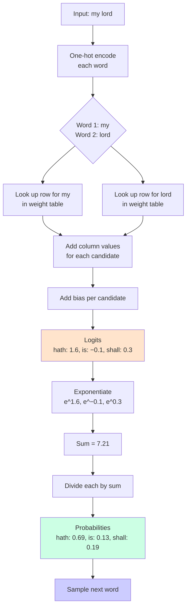

# Bard Forward Pass

Given the input `"my lord"`, Bard produces a score (logit) for every candidate next word. Each score is computed as:

> **score = bias + weight(my, position 1) + weight(lord, position 2)**

## Worked Example

| Candidate | Bias | Weight from `my` | Weight from `lord` | **Logit** |
|-----------|------|------------------|--------------------|-----------|
| `hath`    | 0.1  | 0.5              | 1.0                | **1.6**   |
| `is`      | 0.0  | 0.2              | −0.3               | **−0.1**  |
| `shall`   | −0.1 | 0.0              | 0.4                | **0.3**   |

- **Biases** are the baseline score for each word, independent of context.
- **Weights** capture how each context word pushes each candidate up or down — these are what the model learns.
- Logits can be negative and don't sum to anything meaningful.

## From Logits to Probabilities (Softmax)

1. **Exponentiate** each logit: `e^1.6 ≈ 4.95`, `e^−0.1 ≈ 0.90`, `e^0.3 ≈ 1.35`
2. **Sum** the exponentials: `4.95 + 0.90 + 1.35 = 7.21`
3. **Divide** each by the sum to get probabilities:

| Candidate | Exp   | Probability |
|-----------|-------|-------------|
| `hath`    | 4.95  | **≈ 0.69**  |
| `is`      | 0.90  | **≈ 0.13**  |
| `shall`   | 1.35  | **≈ 0.19**  |

Probabilities are all positive, sum to 1, and the highest logit gets the largest share — yielding a usable distribution over all 7,556 possible next words.

## How the Table Works

Because each input word is **one-hot**, the "multiplication" is really just a row lookup: for each context word, fetch one row from the weight table and add the values in the correct column.

```
Full table: 15,112 words × 7,556 candidates ≈ 114 million numbers
As 32-bit floats: ≈ 456 MB
```

## Implementation (`model.go`)

The latest commit (`3c20718` "softmax") adds the model in Go.

### `Model` struct

```go
type Model struct {
	V    int       // vocab size
	W    []float32 // rows are input features, columns are candidates
	Bias []float32 // one bias per candidate word , so V values in total
}
```

- `W` is a flat array of size `2 * V * V` — treated as a table with `V` columns per row.
- The first `V` rows correspond to context word 1; the next `V` rows to context word 2.
- `NewModel(vocabSize, seed)` initializes small random weights (`~N(0, 0.01)`) and zero biases, so an untrained model gives roughly uniform probabilities.

### `Logits(c0, c1)`

Computes a raw score for every candidate word:

```go
row0 := c0 * m.V
row1 := (m.V + c1) * m.V
z[j] = m.Bias[j] + m.W[row0+j] + m.W[row1+j]
```

### `Softmax(z)`

Converts logits into a probability distribution:

1. Find the max logit and subtract it from every value (numerical stability, prevents overflow).
2. Exponentiate each result.
3. Sum the exponentials.
4. Divide each by the sum.

```go
func Softmax(z []float32) []float32
```

### `Forward(c0, c1)`

Combines the two steps:

```go
func (m *Model) Forward(c0, c1 int) []float32 {
	return Softmax(m.Logits(c0, c1))
}
```

The `main.go` test runs `Forward` on the first example's context (`"THE" "TRAGEDY"`) and prints:
- `Sum of probabilities:` ≈ 1 (softmax normalization)
- `P(correct):` ≈ 1/7556 ≈ 0.00013 (random weights → near-uniform)

## Mermaid Diagram



---

# Training (`train.go`)

A forward pass gives a probability for every candidate word. Training turns
"how wrong was that?" into "which number do I turn, and by how much?"

## The correction: guess minus truth

For one example, the forward pass gives probabilities `p`. The fix for every
candidate word `j` is:

```
correction[j] = p[j] - (1 if j == target else 0)
```

- Positive → the model gave too much probability to a wrong word → lower its logits.
- Negative → the correct word got too little → raise its logits.
- All zeros → the prediction was perfect → nothing to learn from this example.

Read plainly: **"take the share each word got, subtract 1 from the right word."**
If `hath` got 69% but wasn't the answer, it was 69% too high; if `is` was the
answer but got 13%, it was 87% too low. The corrections sum to zero, so
probability is only moved around, never created.

No calculus needed: this *is* the derivative of cross-entropy through softmax
with respect to the logits, but it can be reached by the "how far is each
share from where it should be?" argument.

## Where the correction goes

The logit for candidate `j` is built from exactly three parameters:

```
z[j] = Bias[j] + W[c0][j] + W[V+c1][j]
```

so the same correction is subtracted from all three:

```go
m.Bias[j]    -= lr * d
m.W[row0+j] -= lr * d
m.W[row1+j] -= lr * d
```

Only **two rows** of `W` are touched per example. That sparsity is why the
114M-parameter table is trainable at all.

`Step` measures the loss *before* applying the update and returns it; `Train`
averages those over an epoch and prints loss and perplexity (`e^loss`).

## Plain-SGD vs mini-batch

`Train` uses one example at a time (SGD). It needs no gradient buffer — the
alternative is a second 456 MB `dW` slice. The trade-off is a noisier but
correct update.

## Gradient check

`GradientCheck` computes the analytic correction for one weight and compares it
to a numeric slope `(L(w+ε) − L(w−ε)) / 2ε`. Run it **after** training — early
logits are tiny and the numeric side drowns in float32 rounding noise.

---

# Results

Setup: `NewModel(7556, seed=42)`, `lr = 0.1`, 10 epochs, 31,500 examples.

| epoch | loss   | perplexity |
|-------|--------|------------|
| 0     | 8.9303 | 7556       |
| 1     | 7.4104 | 1653.1     |
| 2     | 6.8152 | 911.6      |
| 3     | 6.5322 | 686.9      |
| 4     | 6.2985 | 543.8      |
| 5     | 6.0892 | 441.1      |
| 6     | 5.8953 | 363.3      |
| 7     | 5.7126 | 302.6      |
| 8     | 5.5386 | 254.3      |
| 9     | 5.3719 | 215.3      |
| 10    | 5.2114 | 183.3      |

Loss after the final epoch's updates: **5.0416**. (The epoch number is measured
before that epoch's updates, so the post-training measurement is slightly lower.)

Gradient check agrees to ~5 digits:

```
W[0][2]  analytic -0.999539   numeric -0.999522
W[0][3]  analytic +0.000063   numeric +0.000072
```

Perplexity fell from **7556** (uniform guessing over the whole vocabulary) to
**~183** — the model is now choosing among roughly 183 plausible words instead
of all 7556. It has not gone to 0 because two words of context cannot determine
every next word in Hamlet; that floor is what a bigger architecture is for.

## Sampling (`gen.go`)

`Sample` divides the logits by `temperature` before softmax, then draws from the
resulting distribution. `1.0` is the trained model; lower is safer, higher is
wilder. `Generate` walks the model from a two-word start.

Same seed and start (`"THE" "TRAGEDY"`), 40 new words:

**temperature 0.5** — stays in distribution, repeats common phrases:

```
THE TRAGEDY and grace to the King. KING. I do you think it be HORATIO. And my lord, I have been The King and a thousand of the King's of his own HORATIO. I am very QUEEN. I have a speech of
```

**temperature 1.0** — correct word-salad of Hamlet's vocabulary:

```
THE TRAGEDY She aim'd depart. world But her in your HORATIO. What very hams. to it that would but much well: And but most going suck'd will speak out of made,— makes one the which shall pray'st of father, in done, that
```

**temperature 1.5** — too hot, vocabulary becomes noise:

```
THE TRAGEDY carters. dust drives, man's Whilst gall thee again. HORATIO. up, gifts,— corruption, King, Sir, advantage, Since morning Now Dost he Thus health Rosencrantz, sandal hearts delight journeys observant Tomorrow Gertrude, part: Denmark me tediousness hits. Well, white upon sleeps. is't,
```

Takeaway: the model has learnt *local* trigram statistics (it knows `KING.` and
`HORATIO.` are speaker labels, that `THE TRAGEDY` comes before a name), but with
only two words of context it cannot hold a sentence together. That is the
limitation the next architecture has to solve.

---

# Tokenizer v2 (`clean.go`)

The v1 tokenizer split on whitespace only, so `KING`, `KING,` and `king` were
three unrelated vocabulary rows. `Retokenize` now lowercases everything, fixes
curly quotes/dashes/`æ`/`à`, turns `&c` into `etc`, and splits punctuation into
its own tokens (apostrophes stay inside words). Underscores are dropped, which
also cleans up leftover stage-direction markers like `_Hic` and `ubique?_`.

`main.go` regenerates `hamlet_clean_tokens.txt` from `hamlet_tokens.txt` on every
run, so the raw file stays untouched.

| | v1 | v2 |
|---|---|---|
| tokens | 31,502 | 39,318 |
| unique words | 7,556 | 4,755 |

Splitting punctuation raises the token count, but words are no longer
fragmented by case or trailing punctuation, so each word is seen in more
training examples.

Retrained with the same settings (`lr = 0.1`, 10 epochs):

| epoch | loss   | perplexity |
|-------|--------|------------|
| 0     | 8.4667 | 4755       |
| 1     | 5.8744 | 355.8      |
| 2     | 5.3212 | 204.6      |
| 3     | 5.0918 | 162.7      |
| 4     | 4.9159 | 136.4      |
| 5     | 4.7663 | 117.5      |
| 6     | 4.6333 | 102.9      |
| 7     | 4.5120 | 91.1       |
| 8     | 4.3997 | 81.4       |
| 9     | 4.2945 | 73.3       |
| 10    | 4.1952 | 66.4       |

Loss after training: **4.0925** (v1 was 5.0416). Perplexity **~66** (v1 was
~183). Gradient check still agrees to ~5 digits.

Sample, temp 0.5:

```
the tragedy , which he is this ? hamlet . i am i will you not . i am i do not , to hamlet . i am my lord . hamlet . the king . how now , i do not
```

Better, but it still slips into loops (`i am i am`). That is the additive
lookup model showing its ceiling: more context per word does not help it keep
track of where the sentence has been.
---

# Train / validation split

The last 10% of the token stream is held out for validation (35,384 train /
3,930 val examples). The split is **contiguous**, not random: adjacent
three-word windows overlap, so a random split would put near-identical windows
on both sides and report a falsely low validation loss.

`Train` now prints both losses every epoch, and `AverageLoss` is reused for
validation (it never updates the model).

| epoch | train  | val    | val perplexity |
|-------|--------|--------|----------------|
| 0     | 8.4667 | 8.4669 | 4755           |
| 1     | 5.9201 | 5.5437 | 255.6          |
| 2     | 5.3487 | 5.4413 | 230.7          |
| 3     | 5.1137 | 5.3960 | 220.5          |
| 4     | 4.9337 | 5.3709 | 215.1          |
| 5     | 4.7805 | 5.3562 | 211.9          |
| 6     | 4.6441 | 5.3477 | 210.1          |
| 7     | 4.5196 | 5.3435 | 209.2          |
| 8     | 4.4042 | 5.3424 | 209.0          |
| 9     | 4.2962 | 5.3435 | 209.2          |
| 10    | 4.1942 | 5.3464 | 209.8          |

After training: train **4.0930**, val **5.3464**.

## What this says

Train loss keeps dropping while validation loss flattens at ~5.34 and then
starts rising after epoch 8. That is textbook **overfitting**: past that point
the model is getting better at the training examples, not at the language. The
~45M-parameter table for 35k examples has plenty of room to memorize.

The honest headline number is therefore **val 5.35 / perplexity ~210**, not the
train 4.09. That also means the earlier "perplexity 66" result was optimistic —
it was measured on data the model had already seen.

To go below the validation floor with this architecture you would need
regularization or a smaller table; to go meaningfully lower you would need a
different model.
